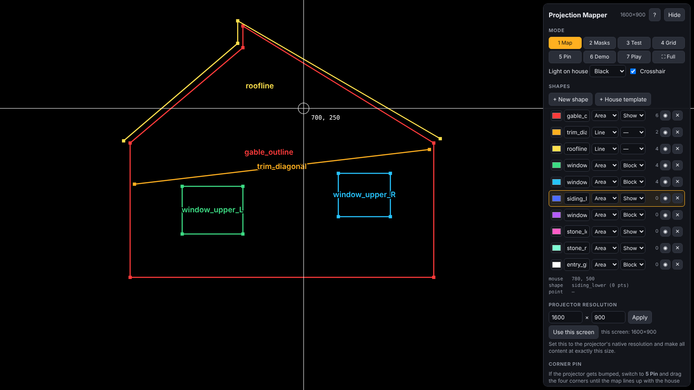
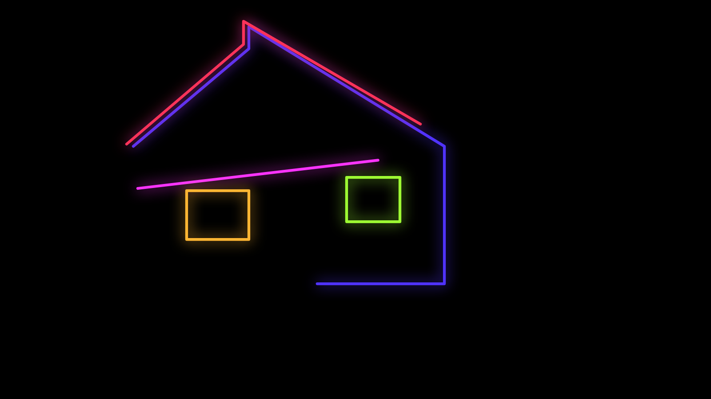

# Projection Mapper

A free projection-mapping tool for houses and buildings that runs in your browser. It's one HTML file: no install, no account, and it works offline.

**▶ Use it now:** https://eac-wirings.github.io/projection-mapper/
**Or download it:** save [`index.html`](index.html) and open it in Chrome or Edge.

## How it works

Most mapping tools warp your video to fit the building at show time. Projection Mapper works the other way around, in **projector space**:

1. Aim the projector at the building and lock it in place.
2. Click on the real features (roofline, windows, trim, stone) while the crosshair is projected onto them. Every point is stored as an exact projector pixel.
3. Export the map as SVG, PNG or JSON guides at the projector's native resolution.
4. Make your content in any editor (After Effects, Blender, DaVinci Resolve, Canva, Inkscape…) with the guide as a reference layer.
5. Play it back full-screen. It lines up pixel for pixel, with no warping needed.

## Features

- **Separate output window (optional):** keep the controls on the laptop screen and send only the projection to the projector. You map by clicking a live preview on the laptop while the crosshair shows up on the building, so the menu never lands on the projection.
- **Map:** a full-screen crosshair; click to add points, drag to move them, arrow keys to nudge 1 px (Shift for 10 px), Alt+click to insert a point on an edge. Undo and redo, plus autosave.
- **Shapes:** areas, lines and point markers, each with a name and color. A one-click **House template** creates the usual parts (gable, roofline, windows, siding, stone, entry).
- **Masks / Test:** check alignment with white masks, or light up each shape one at a time with its name.
- **Grid:** a pixel grid and focus target for setting up the projector.
- **Corner pin:** if the projector gets bumped, drag four corners to realign. The map and playback warp together, so there's nothing to remap.
- **Demo effects:** neon outline trace, rainbow, pulse, lightning, light sweep and fire, all drawn on your own shapes.
- **Playlist playback:** rotate videos and images with crossfades, per-image durations, loop, shuffle and mute. Each shape is *Show* (content plays there), *Block* (forced black, e.g. window glass) or a guide only, and everything outside the Show shapes stays dark.
- **Export:** an SVG guide with named layers, a PNG guide, a PNG color map, one PNG mask per shape, and a JSON map (save and load).
- **Playlist restore:** in Chrome and Edge the playlist comes back after a reload with one click.

## Quick start

1. Connect the projector and set your computer to **extend** the desktop (not mirror it).
2. Open the tool, then either:
   - **One window:** drag the browser window onto the projector and press **F** for fullscreen, or
   - **Two windows:** click **⧉ Open separate output window**, drag the new window onto the projector (Chrome and Edge can place it there for you) and click it to go fullscreen. The controls stay on the laptop.
3. Under **Projector resolution**, click **Use this screen** and check that it matches the projector's native resolution.
4. Turn the projector's keystone correction **off**. Focus with **4 Grid**, then don't touch the projector again.
5. In **1 Map**, press **B** to dimly light the building, add shapes and click their corners. In one-window mode, press **H** to hide the menu so it isn't projected.
6. Export the guides, make your content at exactly that resolution, add it to the **Playlist** and press **Play**.

### Keyboard

| Key | Action |
|---|---|
| Click / drag | Add or move a point |
| Alt + click edge | Insert a point |
| ← ↑ → ↓ | Nudge 1 px (Shift = 10 px); in Play: next / previous |
| `[` `]` | Previous / next point |
| Del | Delete point |
| N / Tab | New shape / next shape |
| 1–7 | Map, Masks, Test, Grid, Pin, Demo, Play |
| B / C | Light on the building / crosshair |
| H / F | Hide UI / fullscreen |
| Ctrl+Z / Ctrl+Shift+Z | Undo / redo |
| Space / Esc | Pause / stop |

## Tips

- In a dark yard, about 3,000 lumens is plenty for a light-colored wall around 25 ft wide.
- Glass doesn't show projection. Close the blinds or hang a white sheet inside a window to turn it into a screen.
- Mark the tripod's position and tape the zoom ring. If it moves anyway, use **5 Pin**.
- Your map is saved in the browser. Use **Save map .json** to keep a backup or to move it to another computer.

## Privacy

Everything runs locally in your browser. Your maps, videos and images never leave your computer.

## License

[MIT](LICENSE)
